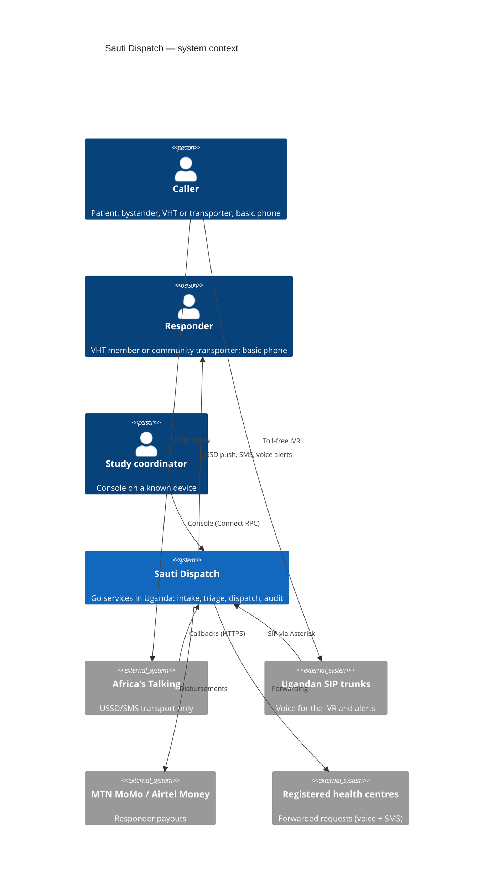

# Architecture

**Type:** Explanation (Diátaxis) · **Spec:** `docs/superpowers/specs/2026-11-12-sauti-dispatch-design.md` · **ADRs:** [index](../adr/README.md)

Sauti Dispatch connects a person reporting a medical emergency, from any basic phone, to the nearest trained Village Health Team member and community transporter. It records the protocol timestamps T1–T7 that the pilot study analyses. One principle shapes the whole design: **all intelligence sits on the server**. Callers and responders need nothing beyond a 2G handset with no data and no airtime (Build Prompt §1; Engineering Guide §3).

## C4 level 1: system context



## C4 level 2: containers (processes and stores)

```mermaid
C4Container
title Sauti Dispatch — containers (M0 built; others planned)
Container(intake, "intake-gw", "Go", "USSD callbacks, sessions, (M1) Tool 1 + triage")
Container(relay, "outbox-relay", "Go", "Outbox to audit ledger; signed checkpoints")
Container(ctl, "sautictl", "Go CLI", "migrate, verify-ledger, verify-projections, demo")
Container(dispatch, "dispatch-worker", "Go + DBOS", "Rings, alert ladder, forwarding (M2)")
Container(ivr, "ivr-controller", "Go + Asterisk ARI", "IVR, alert calls, masked bridge (M1-M2)")
Container(console, "console-api + console", "Go Connect / React", "Live board (M5)")
ContainerDb(op, "operational", "PostgreSQL 18", "Incidents, events, outbox")
ContainerDb(audit, "audit", "PostgreSQL 18", "Hash-chained ledger")
ContainerDb(an, "analytic", "PostgreSQL 18", "Pseudonymised MEDS")
ContainerDb(lk, "linkage", "PostgreSQL 18", "Study ID to incident ID")
ContainerDb(media, "media", "PostgreSQL 18", "Consented interview audio")
Rel(intake, op, "op_intake: write functions only")
Rel(relay, op, "op_relay: claim / mark outbox")
Rel(relay, audit, "audit_appender: append")
Rel(dispatch, op, "op_dispatch")
```

## Bounded contexts and the dependency rule

Each bounded context in `internal/` holds pure domain logic and application services, and declares its ports as Go interfaces:

- `incident`: the aggregate, reducer, reference and commands.
- `audit`: the ledger, relay, checkpoints and verifier.
- `crypto`: envelope encryption, MACs and ML-DSA.
- `config`: versioned configuration.
- `intake`: the USSD session flow.
- `pii`: masked identifier types.

Adapters live in `internal/platform/`; `cmd/` holds the composition roots. A context never imports an adapter, and contexts import each other only along declared edges. `tools/archcheck` enforces both rules in CI ([ADR-0002](../adr/ADR-0002-hexagonal-modular-monolith.md)).

## The write path

```mermaid
sequenceDiagram
    participant AT as Africa's Talking
    participant GW as intake-gw (op_intake)
    participant OP as operational DB
    participant R as outbox-relay
    participant AU as audit DB
    AT->>GW: POST callback (sessionId, text)
    GW->>OP: op.open_incident(...) / op.append_incident_event(...)
    Note over OP: one transaction: idempotency check, version check,<br/>lifecycle check, event row with clock_timestamp(),<br/>projection update, audit outbox row (hash only)
    OP-->>GW: incident, reference, T1
    GW-->>AT: CON/END screen (stored for retries)
    R->>OP: op.claim_outbox (FOR UPDATE SKIP LOCKED)
    R->>AU: audit.append (hash chain, idempotent)
    R->>OP: op.mark_outbox_delivered; commit
    R->>AU: every 5 min: ML-DSA-65 signed checkpoint + witness
```

Three properties follow from this design:

- **Dispatch never waits on audit.** If the audit store is down, the outbox simply grows ([ADR-0004](../adr/ADR-0004-outbox-and-relay.md)).
- **The database is the arbiter of time and of the lifecycle.** A buggy service can neither forge T-times nor skip states ([ADR-0003](../adr/ADR-0003-single-write-path.md)).
- **The audit ledger cannot hold a caller's number.** It stores the payload's hash, never its content ([ADR-0005](../adr/ADR-0005-audit-ledger-checkpoints.md)).

## Robustness mechanisms

| Mechanism | Where |
|---|---|
| Idempotency at every boundary | `op.event_keys`, `op.ussd_steps`, `audit.entries.entry_id` |
| Optimistic concurrency | `expected_version` in `op.append_incident_event` |
| Single active relay with automatic failover | `internal/platform/pg/leader.go` |
| Fail safe to a human | intake always answers with the voice line; escalation port (M2) |
| Dispatch-only readiness | `internal/platform/health/health.go` |
| Defence in depth for PII | `internal/pii/pii.go` masking types, `internal/platform/logging/redact.go`, typed audit columns |
| Egress allowlist | `internal/platform/egress/egress.go` |
| Verifiers | `sautictl verify-ledger`, `sautictl verify-projections` |

## What M0 does not do yet

The Tool 1 flow and triage arrive in M1, dispatch in M2, field reporting in M3, payments in M4, the console in M5, the research data path in M6, and resilience drills in M7. Infrastructure-as-code is P0, and the flagged enhancements are P2. See `docs/superpowers/plans/2026-11-12-phased-roadmap.md`.
